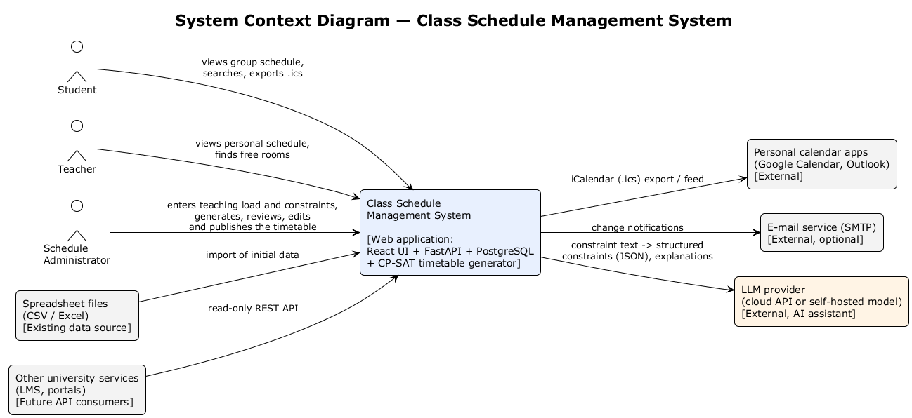
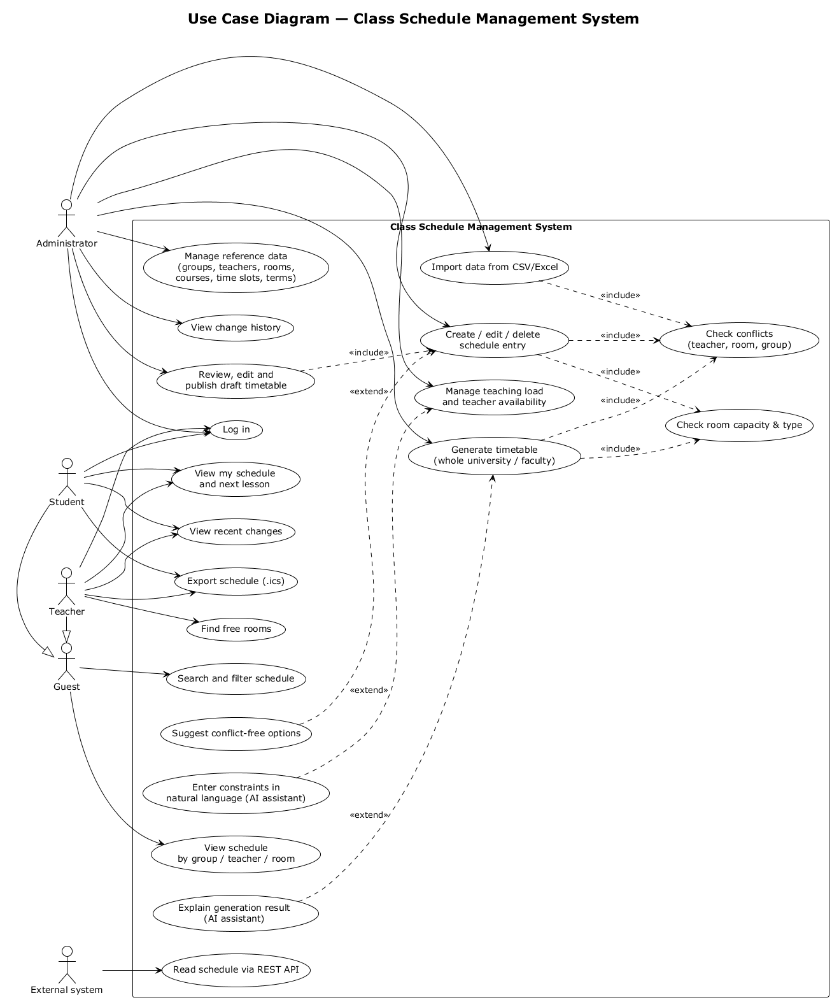
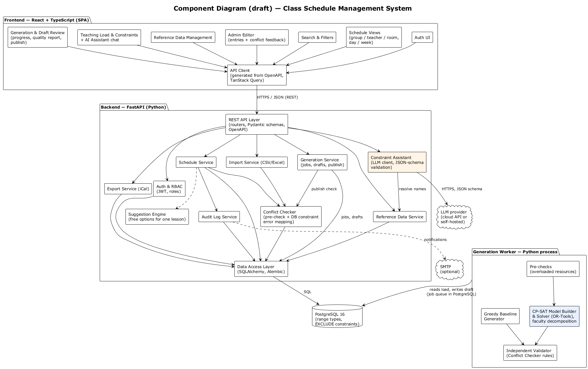
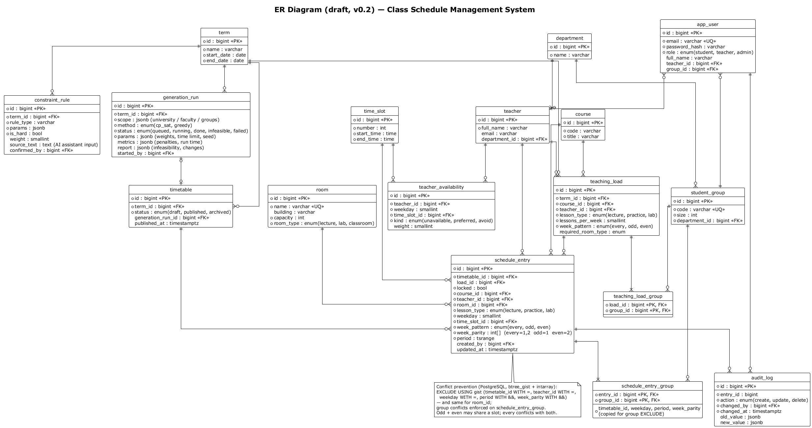

# Architecture and Diagrams

Editable sources are in [`diagrams/src`](../diagrams/src) (PlantUML), exports in [`diagrams/export`](../diagrams/export) (PNG, SVG).
To regenerate: `java -jar plantuml.jar -tpng -o ../export diagrams/src/*.puml`.

## 1. Architectural overview

The system follows a **three-tier client–server architecture**:

1. **Presentation tier** — a React + TypeScript single-page application served as static files. It communicates with the backend only through the REST API.
2. **Application tier** — a FastAPI service organised in layers: API layer (routers, request/response schemas) → service layer (business rules) → data access layer (SQLAlchemy repositories).
3. **Data tier** — PostgreSQL 16, which is not only storage but also the final guard of schedule consistency through constraints.

Next to the application tier runs a **generation worker**: a separate Python process (same codebase) that takes generation jobs from a queue table in PostgreSQL, builds and solves the CP-SAT model and writes the result as a draft timetable. Long solver runs therefore never block API requests. The **AI assistant** calls an external LLM provider (cloud API or self-hosted model) through a provider-independent interface.

All tiers, including the worker, run as containers orchestrated by Docker Compose.

**Key architectural decisions**

| ID | Decision | Rationale | Related requirements |
|---|---|---|---|
| AD-1 | Contract-first REST API described by OpenAPI; frontend client generated from it | Backend and frontend are developed in parallel by different students; the spec is the single source of truth | FR-14, NFR-07 |
| AD-2 | Conflict prevention enforced by PostgreSQL `EXCLUDE` constraints, with an application-level pre-check for user-friendly messages | Application-only checks are vulnerable to race conditions between concurrent edits; DB constraints are atomic | FR-08, NFR-03 |
| AD-3 | Stateless backend with JWT and role-based authorisation dependencies | Simple horizontal scaling, clear permission checks per endpoint | FR-01, FR-02, NFR-04 |
| AD-4 | Audit log written in the same transaction as the schedule change | Change history is always consistent with the data | FR-15, FR-17 |
| AD-5 | Layered backend (API / service / data access) | Business rules are testable without HTTP and without the real DB | NFR-07 |
| AD-6 | Generation runs in a separate worker process; jobs are stored in a `generation_run` table and taken with `SELECT … FOR UPDATE SKIP LOCKED` | Solver runs take minutes; a database-backed queue needs no extra infrastructure (no message broker) and keeps job status and parameters in one place | FR-27, NFR-11, NFR-12, NFR-13 |
| AD-7 | Timetables are versioned (`timetable`: draft / published / archived); every schedule entry belongs to one timetable, and the EXCLUDE constraints include `timetable_id` | A draft can be generated and edited while the published timetable stays unchanged; publication is a status change in one transaction; the database guarantees that every version, generated or manual, is conflict-free | FR-25, FR-27, FR-28 |
| AD-8 | The LLM only proposes constraints in a fixed JSON schema; the backend validates them against reference data, and the administrator confirms them before they are stored; the LLM never writes schedule entries | LLM output may be wrong (hallucinations, `03` [23]); the solver and DB constraints stay the authority; the system works without the LLM | FR-31 – FR-33, NFR-14 |
| AD-9 | Whole-university generation is decomposed by faculty; resources used by already solved faculties are fixed as blocked slots for the next ones; a pre-check finds overloaded resources before solving | Keeps each CP-SAT model small enough for the time limit (`03` [9]) while shared teachers and rooms stay consistent | FR-25, FR-30, NFR-12 |

## 2. System context



The system is used by three human roles (student, teacher, administrator). It exchanges data with personal calendar applications (iCal export), optionally sends e-mail through SMTP, imports existing data from spreadsheets, sends constraint text to an LLM provider for the AI assistant, and exposes a read-only REST API for future university services.

## 3. Use cases



| Use case | Actor(s) | Requirements |
|---|---|---|
| UC01 Log in | Student, Teacher, Admin | FR-01, FR-02 |
| UC02 View schedule by group/teacher/room | Guest and above | FR-10 |
| UC03 Search and filter | Guest and above | FR-11 |
| UC04 View my schedule and next lesson | Student, Teacher | FR-12 |
| UC05 Find free rooms | Teacher | FR-13 |
| UC06 Export schedule (.ics) | Student, Teacher | FR-16 |
| UC07 View recent changes | Student, Teacher | FR-17 |
| UC08 Manage reference data | Admin | FR-03 – FR-06 |
| UC09 Create/edit/delete schedule entry | Admin | FR-07 |
| UC10 Check conflicts (included) | — | FR-08, NFR-03 |
| UC11 Check room capacity & type (included) | — | FR-09 |
| UC12 View change history | Admin | FR-15 |
| UC13 Import from CSV/Excel | Admin | FR-18 |
| UC14 Suggest conflict-free options (extends UC09) | Admin | FR-19 |
| UC15 Read schedule via REST API | External system | FR-14 |
| UC16 Manage teaching load and teacher availability | Admin | FR-23, FR-24 |
| UC17 Enter constraints in natural language (extends UC16) | Admin | FR-31 |
| UC18 Generate timetable (whole university / faculty) | Admin | FR-25 – FR-27, FR-29, FR-30 |
| UC19 Review, edit and publish draft timetable | Admin | FR-28 |
| UC20 Explain generation result (extends UC18) | Admin | FR-32 |

### Main scenario — UC18 "Generate timetable"

1. Admin selects the term and the scope (whole university, a faculty or groups), checks the soft-constraint weights and the time limit, and presses **Generate**.
2. Frontend sends `POST /api/v1/generation-runs`; the backend stores a job with status `queued` and returns `202 Accepted` with the job ID.
3. The worker takes the job and runs **pre-checks**: every load item has a teacher, groups and a suitable room type; no teacher, group or room needs more lessons than it has available slots. Problems → status `infeasible` with a report (FR-30).
4. For each faculty in turn (AD-9), the worker builds the CP-SAT model: one Boolean variable per possible (lesson, day, slot, room); constraints for teacher, room and group no-overlap with odd/even weeks, capacity, room type, unavailability and locked lessons; a weighted objective for gaps, preferences, daily limits and balance. It solves within the time limit.
5. The **Independent Validator** checks the result with the same rules as the Conflict Checker; the entries are inserted into a new **draft** timetable, where the EXCLUDE constraints apply again.
6. The job status becomes `done` with metrics (penalties per soft constraint, run time, number of changes for partial regeneration). The frontend shows progress by polling `GET /generation-runs/{id}`.
7. Admin reviews the draft (UC19), edits it if necessary and publishes it.

**Alternative flows**
- 3a/4a. No feasible timetable → status `infeasible`; the report names the resources involved; the AI assistant can explain it in plain language (UC20).
- 4b. Time limit reached with a feasible but not optimal solution → status `done` with a note; admin may run again with a longer limit.

### Main scenario — UC17 "Enter constraints in natural language"

1. Admin writes: *"Иванов жұма күні түстен кейін сабақ бере алмайды"* ("Ivanov cannot teach on Friday afternoon").
2. Backend sends the text, the list of allowed constraint types and the time-slot table to the LLM with a JSON schema. No e-mails, accounts or timetable data are sent (NFR-14).
3. The LLM returns e.g. `{"type": "teacher_unavailable", "teacher": "Ivanov", "weekday": 5, "slots": [4,5,6], "hard": true}`.
4. Backend resolves "Ivanov" against the teacher list, checks the weekday and slots, and returns the constraint in readable form. If the name is ambiguous or unknown, it asks the admin to choose.
5. Admin confirms; the constraint is stored with its source text (`constraint_rule`, `teacher_availability`).

### Main scenario — UC09 "Create schedule entry"

1. Admin opens the editor and selects term, group(s), course, lesson type, teacher, day, time slot, week pattern and room.
2. Frontend sends `POST /api/v1/schedule-entries`.
3. Backend validates input and RBAC (admin only).
4. Schedule Service performs a pre-check for teacher, room and group conflicts and capacity/type mismatch.
5. Entry and audit record are inserted in one transaction; PostgreSQL `EXCLUDE` constraints guarantee no overlap.
6. Backend returns `201 Created`; the entry appears in all related views.

**Alternative flows**
- 4a/5a. Conflict detected → `409 Conflict` with the conflicting entry (who/what/where) → UI highlights the conflicting field and suggests free alternatives (FR-19, optional).
- 4b. Capacity or room type mismatch → `422` warning; admin may confirm and resend with `force_capacity=true`.

## 4. Components (draft)



| Component | Responsibility | Owner |
|---|---|---|
| Auth UI, Schedule Views, Search & Filters, Admin Editor, Reference Data Management | User-facing screens | Nurzhaina |
| API Client | Typed client generated from OpenAPI, caching with TanStack Query | Nurzhaina |
| REST API Layer | Routing, validation, OpenAPI generation, error format | Zeyin |
| Auth & RBAC | Login, JWT issuing/validation, role checks | Zeyin |
| Reference Data Service | CRUD for groups, teachers, rooms, courses, terms, time slots | Zeyin |
| Schedule Service | Schedule entry lifecycle, queries for views and free rooms | Zeyin |
| Conflict Checker | Pre-checks and mapping of DB constraint violations to readable 409 responses | Zeyin |
| Audit Log Service | Change history, recent-changes feed | Zeyin |
| Export Service | iCalendar generation | Zeyin |
| Import Service | CSV/Excel import with validation | Zeyin (C priority) |
| Suggestion Engine | Conflict-free options for one lesson, ordered by soft-constraint penalty | Zeyin |
| Teaching Load & Constraints UI, AI Assistant chat | Load input, teacher availability grid, natural-language constraint input with confirmation | Nurzhaina |
| Generation & Draft Review UI | Start generation, progress, quality report, draft views, publish | Nurzhaina |
| Generation Service | Generation jobs API, drafts, publication | Zeyin |
| Constraint Assistant | LLM client, prompt and JSON schema, validation against reference data | Zeyin |
| Generation Worker: Pre-checks, CP-SAT Model Builder & Solver, Greedy Baseline, Independent Validator | Builds and solves the model per faculty, baseline for evaluation, validates the result | Zeyin |
| Data Access Layer | SQLAlchemy models, repositories, Alembic migrations | Zeyin |

## 5. Data model (draft)



**Conflict prevention at database level (concept):**

```sql
CREATE EXTENSION IF NOT EXISTS btree_gist;  -- '=' on scalar columns inside GiST
CREATE EXTENSION IF NOT EXISTS intarray;    -- '&&' on integer arrays inside GiST

-- week_parity is derived from week_pattern: every = {1,2}, odd = {1}, even = {2}
-- period is the lesson's time range within the day (e.g. tsrange of the time slot)

-- A teacher cannot have two overlapping lessons on the same weekday in the same timetable
-- (each timetable version — draft or published — is checked separately, AD-7)
ALTER TABLE schedule_entry
  ADD CONSTRAINT no_teacher_overlap
  EXCLUDE USING gist (
    timetable_id WITH =,
    teacher_id  WITH =,
    weekday     WITH =,
    period      WITH &&,
    week_parity gist__int_ops WITH &&
  );
-- The same constraint is defined for room_id, and for group_id on schedule_entry_group.
-- Result: an 'odd' and an 'even' lesson may share a slot, 'every' conflicts with both,
-- and the rule holds even for concurrent transactions (violation -> SQLSTATE 23P01 -> HTTP 409).
```

## 6. API outline (draft)

| Method | Endpoint | Role | Description |
|---|---|---|---|
| POST | `/api/v1/auth/login` | any | Obtain tokens |
| GET | `/api/v1/schedule?group_id=&teacher_id=&room_id=&week=` | guest+ | Schedule for a view |
| GET | `/api/v1/me/schedule` | student, teacher | Personal schedule |
| GET | `/api/v1/rooms/free?weekday=&slot=&type=&min_capacity=` | teacher+ | Free rooms |
| GET/POST/PUT/DELETE | `/api/v1/groups`, `/teachers`, `/rooms`, `/courses`, `/terms`, `/time-slots` | admin (write) | Reference data |
| POST/PUT/DELETE | `/api/v1/schedule-entries` | admin | Manage entries (409 on conflict) |
| GET | `/api/v1/schedule-entries/{id}/history` | admin | Audit log |
| GET | `/api/v1/changes/recent` | student, teacher | Recent changes |
| GET | `/api/v1/export/ics?group_id=` | guest+ | iCalendar export |
| GET/POST/PUT/DELETE | `/api/v1/teaching-load`, `/teachers/{id}/availability`, `/constraints` | admin | Teaching load and constraints |
| POST | `/api/v1/assistant/parse-constraint` | admin | Text → proposed structured constraint (not saved) |
| POST | `/api/v1/assistant/explain/{run_id}` | admin | Plain-language explanation of a generation report |
| POST / GET | `/api/v1/generation-runs`, `/generation-runs/{id}` | admin | Start generation (202 + job ID), status and report |
| GET | `/api/v1/timetables?term_id=&status=` | admin | Draft and published versions |
| POST | `/api/v1/timetables/{id}/publish` | admin | Publish a draft |

Error format (all endpoints): `{ "error": { "code": "SCHEDULE_CONFLICT", "message": "...", "details": {...} } }`.

## 7. Alignment check

| Requirement | Use case | Component | Data | Test (see 09) |
|---|---|---|---|---|
| FR-08 Conflict prevention | UC09, UC10 | Schedule Service, Conflict Checker | `schedule_entry` EXCLUDE constraints | T-INT-03, T-CON-01 |
| FR-10 Views | UC02 | Schedule Views, Schedule Service | `schedule_entry` + joins | T-E2E-01 |
| FR-13 Free rooms | UC05 | Schedule Service | `room`, `schedule_entry` | T-INT-05 |
| FR-15 History | UC12 | Audit Log Service | `audit_log` | T-INT-06 |
| FR-16 iCal | UC06 | Export Service | `schedule_entry` | T-INT-07 |
| FR-23, FR-24 Load and availability | UC16 | Teaching Load UI, Reference Data Service | `teaching_load`, `teacher_availability` | T-INT-09 |
| FR-25 Generation (hard constraints) | UC18 | Generation Service, Worker (CP-SAT, Validator) | `generation_run`, `timetable`, `schedule_entry` | T-GEN-01, T-GEN-02 |
| FR-26 Soft constraints | UC18 | CP-SAT Model Builder, Greedy Baseline | `generation_run.metrics` | T-GEN-03 |
| FR-28 Publish | UC19 | Generation Service, Conflict Checker | `timetable.status` | T-INT-10 |
| FR-29 Partial regeneration | UC18 | CP-SAT Model Builder | `schedule_entry.locked` | T-GEN-04 |
| FR-30 Infeasibility | UC18, UC20 | Pre-checks, Solver | `generation_run.report` | T-GEN-05 |
| FR-31 NL constraints | UC17 | AI Assistant chat, Constraint Assistant | `constraint_rule` | T-AI-01, T-AI-02 |
| NFR-12 Generation time | UC18 | Worker | reference dataset | T-PERF-02 |
